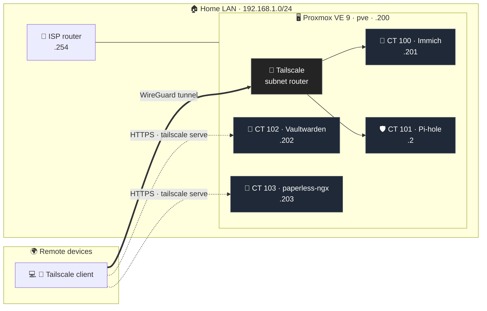

# 🏠 Homelab

**Self-hosted home server on Proxmox VE — private services, zero public exposure.**

---

A home server built on **Proxmox VE**, running private services in lightweight **LXC containers** and reachable remotely only through a **Tailscale** private network.

I built it to learn virtualization, Linux administration and networking hands-on, and to replace cloud services (photos, passwords, documents) with infrastructure I control.

> [!IMPORTANT]
> **Nothing is exposed to the public internet.** Every service is reachable only from authorized devices on my tailnet.

## 📑 Contents

- [Architecture](#-architecture)
- [Hardware](#-hardware)
- [Services](#-services)
- [Networking & remote access](#-networking--remote-access)
- [Operations](#%EF%B8%8F-operations)
- [Lessons learned](#-lessons-learned)
- [Roadmap](#%EF%B8%8F-roadmap)

---

## 🗺 Architecture

> [!TIP]
> **Two ways in.** Immich and Pi-hole are reached through the host acting as a **subnet router**. Vaultwarden and paperless-ngx are **tailnet nodes themselves**, so they get their own name and a valid HTTPS certificate.

## 🔧 Hardware

| | |
|---|---|
| **Hypervisor** | Proxmox VE 9, single node (`pve`) |
| **CPU / RAM** | 4 cores · ~8 GB |
| **Storage** | 1× ~500 GB SSD (`local-lvm`) — host + all containers |
| **Network** | Linux bridge `vmbr0`, static addressing |

## 📦 Services

| | Service | Purpose | Access |
|:-:|---|---|---|
| 📸 | **Immich** · `CT 100` | Phone photo backup and gallery | Subnet router |
| 🛡 | **Pi-hole** · `CT 101` | Local DNS + ad blocking (upstream: Cloudflare) | LAN |
| 🔐 | **Vaultwarden** · `CT 102` | Bitwarden-compatible password manager | 🔒 HTTPS via `tailscale serve` |
| 📄 | **paperless-ngx** · `CT 103` | Document archive for university material, by subject | 🔒 HTTPS via `tailscale serve` |

<b>Deployment details</b>

 

- **Immich** — Docker Compose in a Debian LXC, in `/opt/immich`; library and Postgres database live in the same folder.
- **Pi-hole** — Debian 12 LXC with a static IP.
- **Vaultwarden** — Docker Compose in a Debian 12 LXC, in `/opt/vaultwarden`.
- **paperless-ngx** — Docker Compose in a Debian 12 LXC (2 cores, 2 GB RAM), with a dedicated 30 GB data disk mounted at `/mnt/paperless`.

All containers use **static IPs** and **start at boot**.

## 🌐 Networking & remote access

- **Subnet router** — Tailscale on the Proxmox host advertises `192.168.1.0/24` to the tailnet, so services without Tailscale installed (such as Immich) are still reachable remotely.
- **Real HTTPS** — Vaultwarden and paperless-ngx run Tailscale inside their containers and get valid certificates through `tailscale serve`. Vaultwarden *requires* this: browsers only allow its web vault's cryptography over HTTPS.
- **Funnel disabled** — nothing is reachable from outside the tailnet.
- **DNS** — moving toward Tailscale **MagicDNS**.

> [!NOTE]
> Pi-hole is installed, but the ISP router doesn't allow custom DNS servers, so it can't be set as the network-wide resolver yet.

## ⚙️ Operations

| | |
|---|---|
| 🌙 **Scheduled power cycling** | The host shuts down around 01:00 and wakes at 08:00 with `rtcwake` and a systemd timer; containers return automatically on boot |

## 🛣️ Roadmap

- [ ] ☁️ **Nextcloud** — shared file space with friends for university material
- [ ] 📊 **Grafana** — monitoring of the host and services
- [ ] 💾 **3-2-1 backups** — Borg from my PCs to the server, plus a nightly encrypted `rclone sync` off-site
- [ ] 🔁 **NetBird (self-hosted)** — evaluating it as a Tailscale replacement
- [ ] 🖥 **Second node** — HP ProDesk 600 G3 DM (i5-7500T, 12 GB RAM), plus a mini PC for **OpenWRT** experiments
- [ ] ☸️ **Clustering** — Proxmox cluster, then **Kubernetes** on top (needs a third node or a QDevice for quorum)
